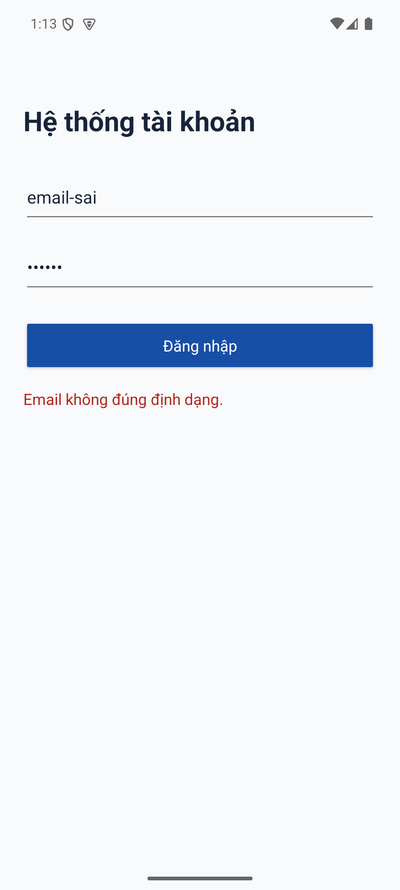
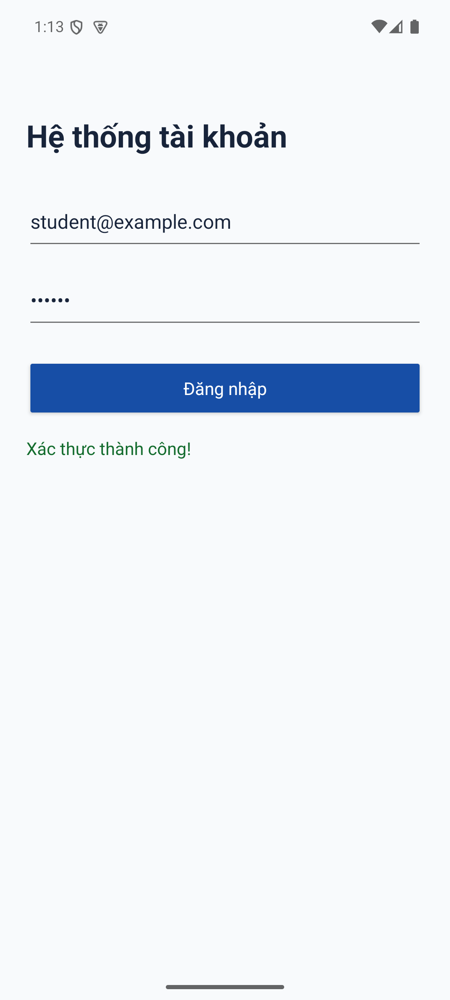
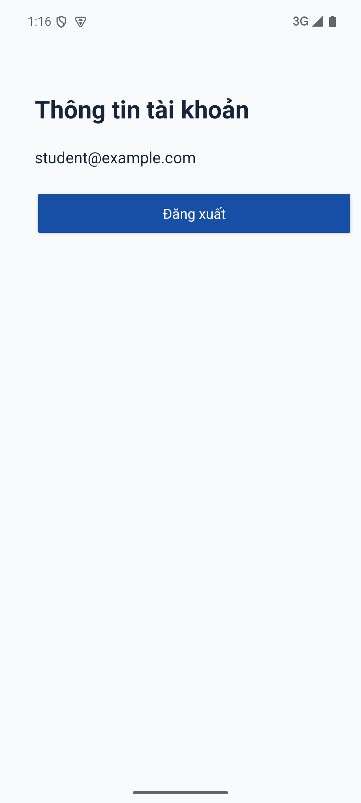

# Kiểm tra Lập trình Ứng dụng Di động

- Họ tên: Nguyễn Văn Tùng Dương
- MSSV: 2374802010086
- Project: `KiemTra_LapTrinhUngDungDiDong_2374802010086`
- Nhánh hiện tại: `cau-2`

## Câu 1: Đăng nhập và kiểm tra dữ liệu

Giao diện Kotlin + XML dùng ConstraintLayout phẳng. LoginActivity ánh xạ bằng `findViewById`; ViewBinding tắt trong cấu hình build.

Khi bấm **Đăng nhập**, ứng dụng kiểm tra trường trống, định dạng Email bằng `Patterns.EMAIL_ADDRESS` và mật khẩu có ít nhất 6 ký tự. Thông báo nằm trên TextView trạng thái. Email được loại khoảng trắng ở hai đầu; mật khẩu giữ nguyên.

Đây là bài thực hành kiểm tra dữ liệu nhập, không kết nối máy chủ hay xác minh tài khoản thật. Có thể dùng Email bất kỳ đúng định dạng và mật khẩu từ 6 ký tự.

## Chạy và kiểm thử

Mở thư mục project bằng Android Studio. Dùng JDK 25, Android SDK 37, Gradle 9.5.0 và Android Gradle Plugin 9.3.3. AGP 9 tích hợp Kotlin; không cần thêm plugin Kotlin. Ứng dụng hỗ trợ Android 7.0 (API 24) trở lên.

Trên Windows:

```bat
gradlew.bat assembleDebug lintDebug
gradlew.bat connectedDebugAndroidTest
```

Lệnh thứ hai cần emulator hoặc thiết bị Android đã bật USB debugging. Bộ kiểm thử kiểm tra trường trống, Email sai, mật khẩu 5/6 ký tự và khoảng trắng quanh Email.

Hai kiểm thử dữ liệu hợp lệ ở Câu 1 được chuyển sang ProfileNavigationTest để kiểm tra điều hướng, Email nhận được và đăng xuất. Có thêm kiểm thử giữ Email sau khi Activity được tạo lại.

Đã kiểm tra trên emulator API 35: 8/8 kiểm thử đạt; assembleDebug và lintDebug thành công. Lint còn cảnh báo đề xuất cập nhật thư viện, cấu hình sao lưu và app indexing; không có lỗi.

## Minh chứng Câu 1

Ảnh chụp trực tiếp trên Android Emulator API 35.

### Email không hợp lệ



### Xác thực thành công



## Câu 2: Intent và Bundle

LoginActivity tạo Intent tường minh tới ProfileActivity. Email nằm trong Bundle với khóa `email`; Bundle đi qua `putExtra("account", account)`. ProfileActivity dùng `getBundleExtra("account")` và `getString("email")` để lấy Email rồi gán lên TextView.

Nút **Đăng xuất** gọi `finish()`, đóng ProfileActivity và trở về LoginActivity. Hai Activity đều dùng `findViewById`.

### Minh chứng Câu 2



Hai ảnh Câu 1 giữ lại minh chứng của nhánh `cau-1`; từ Câu 2, đăng nhập hợp lệ sẽ mở ProfileActivity.

## Cấu trúc nhánh

Repository có đúng ba nhánh:

| Nhánh | Nội dung |
| --- | --- |
| `cau-1` | Đăng nhập, findViewById, kiểm tra dữ liệu |
| `cau-2` | Kế thừa Câu 1, thêm Profile, Intent và Bundle |
| `cau-3` | Kế thừa Câu 2, thêm ListView, ArrayAdapter và Toast |

Chuyển nhánh bằng `git checkout cau-1`, `git checkout cau-2` hoặc `git checkout cau-3`, rồi build lại để kiểm tra từng câu.
